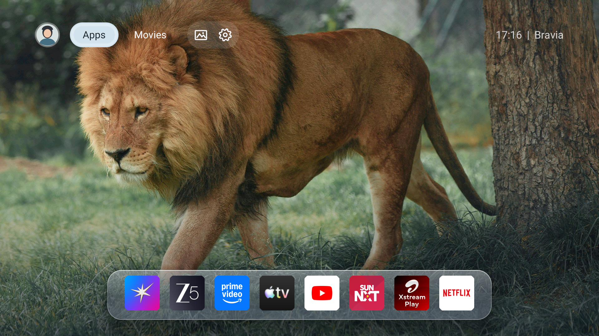

# Dumb TV

**Make your smart TV dumb again.**

A simple Android TV launcher with your apps, a clock, and cute & serene wallpapers. No recommendation feed or sponsored rows in the launcher.

## Features

- Choose which apps appear on your home screen.
- Use a fixed wallpaper or rotate through a curated Pexels collection.
- Block network access for selected TV recommendation and viewing-recognition apps with a local firewall.
- Configure AdGuard Private DNS with a one-time ADB permission grant.
- Browse Jellyfin movies after configuring your server and signing in. This requires setup before it works.

**Ad protection is experimental and currently not working.** It is under development and should not be relied on to hide or mute ads.

Built for Android TV / Google TV. Requires Android 7.0 (API 24) or newer. Other TVs and firmware need testing.

## Screenshots

Home screen with the app dock:



This screenshot shows an earlier development build. The launcher label and Settings have since changed.

## Build and install

Requirements: JDK 17, Android SDK platform 34, and an authorized ADB connection to your TV.

Set `JAVA_HOME` to JDK 17. Set `ANDROID_HOME` to your Android SDK, or add `sdk.dir` to a local `local.properties` file.

```sh
git clone https://github.com/spkprav/dumb-tv.git
cd dumb-tv
./gradlew assembleDebug testDebugUnitTest
adb install -r app/build/outputs/apk/debug/app-debug.apk
```

Open **Dumb TV → Settings → General → Default launcher** and select **Dumb TV**.

If your TV hides the Home picker:

```sh
adb shell cmd package set-home-activity org.dumbtv.launcher/.MainActivity
adb shell input keyevent KEYCODE_HOME
```

If Home still opens Google TV, enable **Dumb TV Home button override** in Android's Accessibility settings. Keep the stock launcher installed so you can switch back in Android's default Home settings.

## Setup

### Apps and wallpapers

Choose your home-screen apps in **Settings → Apps**. Hold OK on an app for management options.

Change the wallpaper and rotation interval in **Settings → Appearance**. Select **Fixed** to use the bundled wallpaper without image downloads. Rotating wallpapers download from Pexels; see [photo sources and credits](design/wallpaper-sources.md).

### Tracker firewall

Enable it in **Settings → General → Privacy & tracking** and approve Android's VPN prompt. Check Settings for its current status.

The firewall drops selected apps' traffic locally. It uses Android's VPN slot and can replace another active VPN. Leave **Block connections without VPN** off so streaming apps and Jellyfin can connect normally.

It does not prevent all tracking. See [PRIVACY.md](PRIVACY.md) for targets, permissions, data storage, and limitations.

### DNS filtering

Grant permission once through ADB:

```sh
adb shell pm grant org.dumbtv.launcher android.permission.WRITE_SECURE_SETTINGS
```

Enable **DNS blocking** in **Settings → Connections**. It uses `dns.adguard-dns.com`. DNS filtering does not remove all ads, including ads served from the same domains as video.

### Jellyfin

Jellyfin does not work out of the box. You need a reachable Jellyfin server and the Jellyfin Android TV client.

Before building:

The default `jellyfin.example.invalid` address is a placeholder and will not connect.

1. Set `SERVER` in [JellyfinLibrary.kt](app/src/main/java/org/dumbtv/launcher/jellyfin/JellyfinLibrary.kt) to your server address.
2. Update the allowed host in [network_security_config.xml](app/src/main/res/xml/network_security_config.xml). The current HTTP setup is intended only for a trusted LAN.

After installing, open **Settings → Connections → Movie library** and sign in or use Quick Connect. Sign in to the same server and intended profile in the Jellyfin Android TV client.

The shelf shows up to 24 recently added movies. Selecting a movie opens its details in the Jellyfin client. A server-address setting is not available yet.

## Development

Built with Kotlin, Jetpack Compose, and Android TV Material.

```sh
./gradlew testDebugUnitTest assembleDebug
```

For performance testing:

```sh
./gradlew assemblePerformance
adb install -r app/build/outputs/apk/performance/app-performance.apk
bash scripts/capture-tv-performance.sh
```

The performance build uses the local debug signing key and is for development only. Device testing is still required for navigation, firewall behavior, and reboot persistence.

- [Script guide](scripts/README.md): requirements, commands, device selection, outputs, and cleanup.
- [Experimental ad-protection guide](docs/testing/ad-protection.md): manual checks and diagnostic exports.

Generated diagnostics go in the ignored `artifacts/` directory. Review screenshots and logs for personal information before sharing them.

## Fork my code, not my preferences.

Build yours on top of it.

I built Dumb TV for my TV, my apps, and how I use them. The dock order, wallpapers, and layout reflect my preferences. They don't have to be yours.

Use this code and the documented research as a base. Ask Claude, Codex, OpenCode, or whatever you use to change it around your needs—or rebuild the interface entirely. You don't have to repeat the research behind the local VPN firewall, DNS filtering, and TV launcher behavior. The docs also explain the limitations and what doesn't work yet.

Want a different dock order? Start with `app/src/main/java/org/dumbtv/launcher/apps/HomeApps.kt`. Want different wallpapers, fewer features, or another layout? Change them. Build it, install it, and make it your own.

## License

[MIT](LICENSE). Fork it, change it, sell it. Keep the copyright and license notice.

If you add sponsored rows back in, that's between you and your conscience.

Third-party dependencies and photos retain their own licenses and terms.
